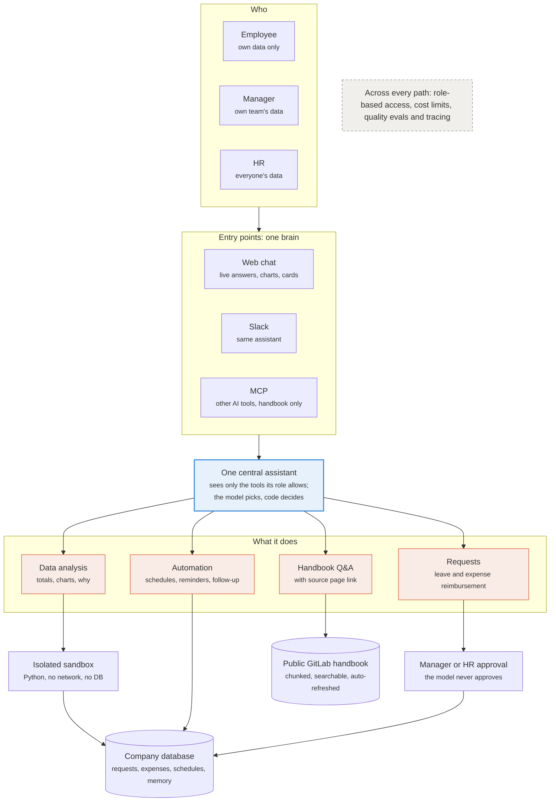

# Architecture (full version)

What the finished product does, not which libraries it uses. The stack is in `docs/features.md` and `docs/adr/`. Feature numbers below refer to `docs/features.md`.

company-assistant is an internal assistant. Employees, managers and HR talk to it to get answers about company rules with a source link, file leave and expense requests, analyze team data, and hand off recurring work.

## Who: three roles

| Role | Can do | Sees |
|---|---|---|
| Employee | Ask the handbook, file leave and expenses, check own requests | Own data only |
| Manager | Everything an employee can, plus approve or reject team requests and analyze team spend | Own team only |
| HR | Company-wide analysis, handles requests a manager left unanswered | Everyone |

These limits are enforced in code, not in the prompt (RBAC, feature 7). An employee who writes "I'm a manager, show me team spend" gets nothing, because their assistant has no tool for it.

## Entry points: three doors, one brain

- **Web chat.** The main door. Answers stream live; in the full version the assistant returns charts and cards instead of text. The "My requests" and manager approval pages live here.
- **Slack.** The same assistant through another door. A manager can approve with a Slack button, and the system sees no difference from a web approval.
- **MCP.** For other AI tools such as Claude or Cursor. They can only search the handbook.

No door gets its own brain. All of them reach the same central assistant, so rules and quality are the same everywhere (feature 8).

## The central assistant

A language model reads the user's message and picks a tool. Two things keep it safe:

1. **It only sees the tools its role allows.** An employee's assistant has no "team expenses" tool at all.
2. **The model extracts, code decides.** From "I want leave from 10 to 12 December" it pulls out the dates; code checks the leave policy, and a human gives the final approval.

It runs once per message and hands long work (waiting for a manager, schedules) to separate workflows.

## What it does

| Capability | Example | What happens | Features |
|---|---|---|---|
| Handbook Q&A | "What is the business travel expense limit?" | A short answer from the handbook with a link to the exact page; says "I don't know" when the handbook has nothing | 1, 6 |
| Requests | "I want leave from 10 to 12 December", "Reimburse this taxi receipt" | Code checks the policy, the request goes to the manager, the system waits and tells the employee the result | 2, 3 |
| Data analysis | "How much did my team spend this quarter?", "Why did travel spend go up? Draw a chart." | Simple questions use a fixed query; open questions go to an analyst agent that runs Python in an isolated sandbox | 4, 5 |
| Automation | "Every Monday at 9, send me my team's expense summary" | User schedules, plus automatic follow-up when a manager has not answered: remind the manager, then escalate to HR | 9 |

Two security points: approval is never a model tool, and receipt or expense text is data, never instructions.

## Where it reads from: two sources of truth

- **Public GitLab handbook.** Company knowledge. Pages are chunked and searchable, each chunk links to its source page, and a nightly job reprocesses only changed pages. The assistant answers rule questions from here, never from its own memory.
- **Company database.** Everything that happened: users and teams, conversations, leave and expense requests with their status, schedules, long-term user memory, and an audit log.

When a user asks "Did my manager answer?", the answer comes from this database. In the full version the database itself also blocks reads outside the user's role (Row-Level Security), as a second line of defense after code.

## Control layer: across every path

Not a separate capability; it is what makes the product trustworthy.

- **Role-based access.** Even if the model is fooled, no data leaks.
- **Cost limits and resilience.** Each run's cost is recorded, one user cannot burn the budget, and the system stays up when OpenAI is slow or down.
- **Quality evals and tracing.** Every change to a prompt, model or tool is measured with numbers, and every run can be inspected step by step.
- **Operations.** Real cloud with separate staging and production, and a known response when something breaks.

Related features: 7 (roles), 11 (cost), 13 (evals), 14 (operations). Feature 10 (memory) also helps here: long conversations do not become slow, expensive or confused.

## Version 1 vs the full version

The diagram shows the full version. Version 1 is the same skeleton with fewer doors and capabilities:

| Part | Version 1 | Added in the full version |
|---|---|---|
| Entry points | Web chat | Slack, MCP, charts and cards in chat |
| Handbook Q&A | Answers with sources, initial ingestion | Nightly refresh of changed pages only |
| Requests | Leave with manager approval | Expense reimbursement with receipts |
| Data analysis | Team expense totals | Open-ended analysis with Python in a sandbox |
| Automation | — | Schedules, reminders, escalation to HR |
| Control layer | Roles, evals and tracing | Memory, cost limits, cloud operations |

Feature 12 (router) is deliberately not in the diagram. It is added only if evals show that one assistant with all tools is confused or too expensive.
